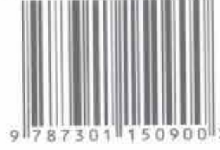

这本教科书的最大特点是它的“学生导向”，如作者自己指出的，他要写的是一本学生喜欢看的经济学教科书。与其他同类教科书相比，本书强调得更多的是经济学原理的应用和政策分析，而不是正式的经济学模型。为此，作者在大部分章节里都提供了案例，以说明经济学原理如何应用于现实经济问题的分析。此外，作者在书中还提供了大量的“新闻摘录”，以使读者懂得什么是生活中的经济学。

——张维迎

曼昆的东西让你觉得，学经济学原来也是一种享受。

——梁小民

## 本书创造了两项吉尼斯世界纪录

一是本书尚未完稿时，出版商就出价140万美元买下其版权，从而创下经济学著作卖价的吉尼斯世界纪录。

二是本书一出版便很快风行美国，出版仅3个月就被300多所大学采用为教材。其英文版发行量在1998年出版当年就高达20万册，成为世界上首版最成功的经济学教材。其畅销性又创下吉尼斯世界纪录。

Principles of Economics

CENGAGE Learning

上架建议：经济学

ISBN 978-7-301-150900-0

9787301150900>

定价：42.00元

www.cengageasia.com

网络加速器

t.tizi8.com

t.it520.cc

t.hi6.uk