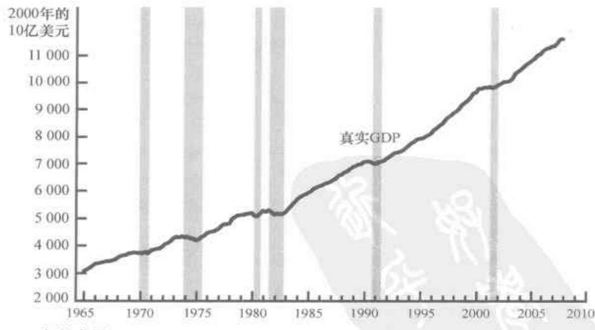

的百分比。如果用 GDP 平减指数，两个相连年份的通货膨胀率用如下方法计算：

$$  第二年的 GDP\_{ 第一年的 GDP} $$

$$  第二年的通货膨胀率 =\frac{ 平减指数 }{ 第一年的 GDP 平减指数 }\times100\% $$

由于2009年的GDP平减指数从100上升到171，所以，通货膨胀率就是 $100\%\times(171-100)/100$，即71%。在2010年，GDP平减指数从前一年的171上升到240，因此，通货膨胀率是 $100\%\times(240-171)/171$，即40%。

GDP 平减指数是经济学家用来监测经济中平均物价水平，从而监测通货膨胀率的一个衡量指标。GDP 平减指数的得名是因为它可以用来从名义 GDP 中剔除通货膨胀——也就是说，“平减”名义 GDP 中由于物价上升而引起的上升。在下一章中，我们将考察经济中物价水平的另一个衡量指标，称为消费物价指数，届时我们还要说明这两个衡量指标之间的差别。

## 案例研究

## 近年来的真实 GDP

既然我们知道了如何定义和衡量真实GDP，那么我们就来考虑这个宏观经济变量说明了近年来美国经济的什么情况。图23-2显示了1965年以来美国经济真实GDP的季度数据。

图 23-2 美国的真实 GDP

资料来源：U.S. Department of Commerce.

这些数据最明显的特点是真实GDP一直在增长。美国经济2007年的真实GDP几乎是1965年水平的4倍。换言之，美国生产的物品与劳务的产量平均每年增长3.2%左右。这种真实GDP的持续增长使普通美国

该图显示了1965年以来美国经济真实GDP的季度数据。衰退——真实GDP下降的时期——用垂直的阴影条表示。

第 23 章 一国收入的衡量

15

网络加速器
t.tizi8.com
t.it520.cc
t.hi6.uk