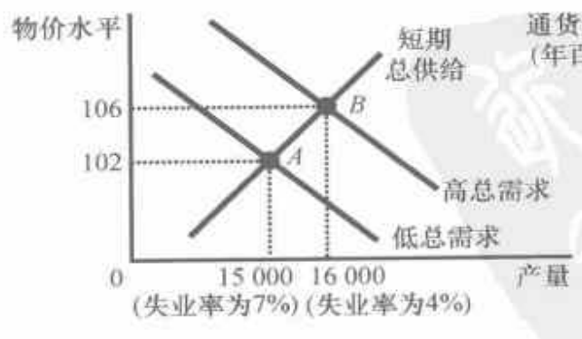
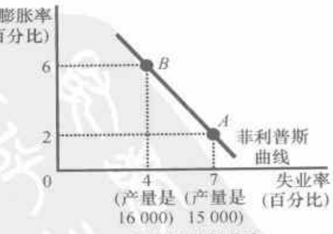

804

该图假设2020年物价水平为100，并画出了2021年的可能结果。（a）幅表示总需求与总供给模型。如果总需求低，经济在A点，产量低（15000）且物价水平也低（102）。如果总需求高，经济在B点，产量高（16000）且物价水平也高（106）。（b）幅显示了菲利普斯曲线的含义。当总需求低时得出了A点，失业率高（7%），而通货膨胀率低（2%）。当总需求高时得出了B点，失业率低（4%），而通货膨胀率高（6%）。

正如萨缪尔森和索洛的文章题目所表明的，他们关心菲利普斯曲线是因为他们相信这对决策者来说是一个重要的结论。特别是，他们说明了菲利普斯曲线给决策者提供了一个有各种可能的经济结果的菜单。通过改变货币政策与财政政策来影响总需求，决策者可以选择这条曲线上的任意一点。A点提供了高失业和低通货膨胀。B点提供了低失业和高通货膨胀。决策者可能会偏好低通货膨胀和低失业，但正如菲利普斯曲线概括的历史数据所表明的，这种组合是不可能的。根据萨缪尔森和索洛的看法，决策者面临着通货膨胀和失业之间的权衡取舍，并且菲利普斯曲线说明了这种权衡取舍。

#### 35.1.2 总需求、总供给和菲利普斯曲线

总需求与总供给模型为菲利普斯曲线所描述的有各种可能结果的菜单提供了一个简单的解释。菲利普斯曲线说明了，短期中出现的通货膨胀与失业的组合是由于总需求曲线的移动使经济沿着短期总供给曲线变动。正如我们在前两章中所看到的，在短期中物品与劳务总需求的增加引起产量增加、物价总水平上升。产量越多，意味着就业越多，从而失业率越低。此外，高物价水平转变为高通货膨胀率。因此，总需求变动在短期中使通货膨胀和失业反方向变动，这正是菲利普斯曲线所说明的一种关系。

为了更充分地说明这是如何发生作用的，我们来看一个例子。为了使数字简化，设想物价水平（例如，用消费物价指数衡量）在2020年等于100。图35-2表示由于总需求的力量在2021年可能出现的两种结果，一种结果是在总需求高时出现的，另一种结果是在总需求低时出现的。其中，(a) 幅用总需求与总供给模型表示这两种结果；(b) 幅用菲利普斯曲线表示同样的两种结果。

图 35-2 菲利普斯曲线如何和总需求与总供给模型相关

(a) 总需求与总供给模型

(b) 菲利普斯曲线

图 35-2(a) 幅显示了 2021 年产量和物价水平发生的变动。如果物

294

经济学原理

网络加速器
t.tizi8.com
t.it520.cc
t.hi6.uk