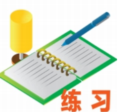

��.2 一元二次方程的解法

练习

1. 填空：

(1) $x^{2}-2x+\_\=(x-\_\)^{2}$;

(2) $x^{2}+8x+\_\=(x+\_\)^{2}$;

(3) $x^{2}-5x+\_\=(x-\_\)^{2}$;

(4) $x^{2}+\frac{3}{2}x+\_\=(x+\_\)^{2}.$

2. 解下列方程：

(1) $x^{2}+2x=3$;

(2) $x^{2}-6x=4$;

(3) $x^{2}+10x+20=0$;

(4) $x^{2}-x-1=0$.

当一元二次方程的二次项系数不是1时，怎样用配方法求解？

把二次项系数化为1.

例 4 解方程： $2x^{2}-5x+2=0$

解：两边都除以2，得

$$ x^{2}-\frac{5}{2}x+1=0. $$

移项，得

$$ x^{2}-\frac{5}{2}x=-1. $$

配方，得

$$ x^{2}-\frac{5}{2}x+\left(\frac{5}{4}\right)^{2}=-1+\left(\frac{5}{4}\right)^{2}, $$

$$ \left(x-\frac{5}{4}\right)^{2}=\frac{9}{16}. $$

解这个方程，得

$$ x-\frac{5}{4}=\pm\frac{3}{4}. $$

所以

$$ x_{1}=\frac{1}{2},x_{2}=2. $$

13