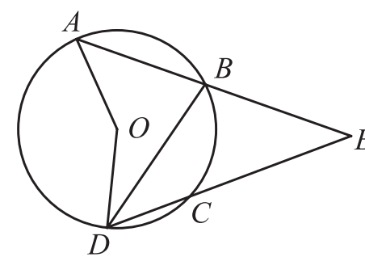
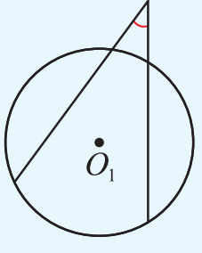
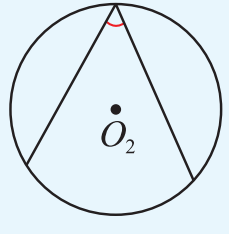
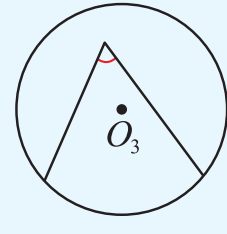
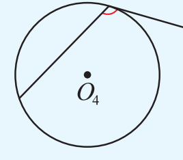

��.4 圆周角

于是，我们得到如下定理：

圆周角的度数等于它所对弧上的圆心角度数的一半，同弧或等弧所对的圆周角相等。

因为圆心角的度数与它所对的弧的度数相等，所以我们也可以说，圆周角的度数等于它所对弧的度数的一半。

例 1 如图 2-27，���O 的弦 AB、DC 的延长线相交于点 E， $\angle AOD = 150^{\circ}$， $\widehat{BC}$ 为  $70^{\circ}$。求  $\angle ABD$、 $\angle AED$ 的度数。

解：在���O中，

图 2−27

$\because \angle AOD = 150^{\circ},$

$\therefore \angle ABD = 75^{\circ}$ (圆周角的度数等于它所对弧上的圆心角度数的一半).

$\because \widehat{BC}$ 为  $70^{\circ}$,

$\therefore \angle BDC = 35^{\circ}$ (圆周角的度数等于它所对弧的度数的一半).

又��  $\angle ABD = \angle AED + \angle BDC$,

$\therefore \angle AED = \angle ABD - \angle BDC = 75^\circ - 35^\circ = 40^\circ.$

1. 下列各图中的角是否是圆周角？为什么？

��

��

��

��

(第1题)

55