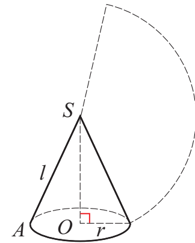
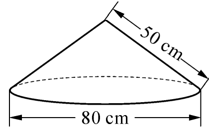
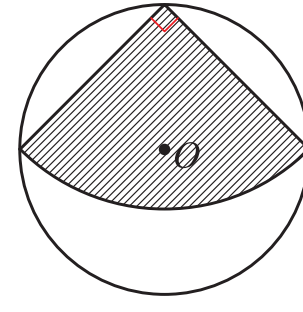

第2章 对称图形——圆

### 2.8 圆锥的侧面积

我们把连接圆锥的顶点和底面圆上一点的线段叫做圆锥的母线．如图 2−62，线段 SA 是圆锥的母线．

在图 2−62 中，设圆锥的母线长为 l，圆锥的底面圆半径为 r，你能计算圆锥的侧面积吗？

图 2−62

圆锥的侧面展开图是一个扇形.

这个扇形的那长是圆锥底面圆周长，半径是圆锥的母线长，圆锥的侧面积为 $\frac{1}{2}2\pi r l=\pi r l$.

例 用铁皮制作的圆锥形容器盖如图 2−63 所示，求这个容器盖铁皮的面积(精确到  $1 \, cm^{2}$).

解：圆锥形容器盖的底面圆周长为  $2\pi \times 40 = 80\pi$.

容器盖的面积

$$ \begin{aligned}S&=\frac{1}{2}\times80\pi\times50\\&\approx6\ 280.\end{aligned} $$

图 2−63

答：这个圆锥形容器盖铁皮的面积约为  $6280 \, cm^{2}$

在半径为 $\sqrt{2}$的圆形纸片中，剪一个圆心角为 $90^{\circ}$的扇形(图2-64中的阴影部分).

(1) 求这个扇形的面积(结果保留  $\pi$);

(2) 若用剪得的扇形纸片围成一个圆锥的侧面，能否从剪下的 3 块余料中选取一块，剪出一个圆作为这个圆锥的底面？

图 2−64

86