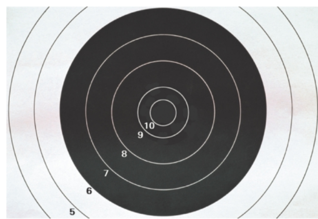
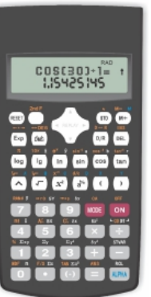
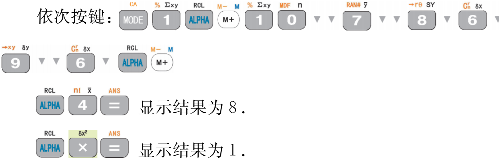
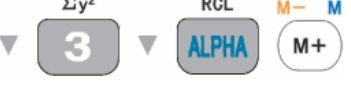

第 3 章 数据的集中趋势和离散程度

### 3.5 用计算器求方差

我们也可以用计算器来计算一组数据的平均数、方差。

甲、乙两人在相同条件下 10

次射击的成绩如下(单位：环)：

甲：10，7，8，8，8，8，8，

8，9，6；

乙：8，8，8，8，5，8，8，

9，9，9.

用计算器计算这两组数据的平均数、方差，比较甲、乙两人射击成绩的稳定性。

方法一：

按开机键 ON 后，首先将计算器功能模式设定为统计模式，

依次按键：

显示结果为 8.

显示结果为 1.

即甲射击成绩的平均数  $\bar{x}=8$，方差  $s^{2}=1$。

依次按键：

显示结果为 8.

显示结果为 1.2.

即乙射击成绩的平均数  $\bar{x}=8$，方差  $s^{2}=1.2$。

118