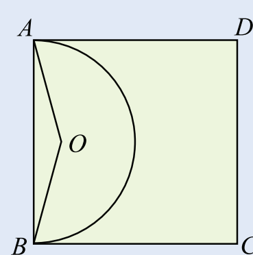

4 数学活动

在正方形 ABCD 内任取一点 O，连接 OA、OB（如图）。如果正方形 ABCD 内每一点被取到的可能性都相同，分别求  $\triangle OAB$ 是钝角三角形和直角三角形的概率。

“△OAB 是钝角三角形”这个事件发生相当于点 O 恰好落在以 AB 为直径的半圆内，所以

$P(\triangle OAB$ 是钝角三角形 $)=\frac{AB$ 为直径的半圆的面积}{正方形 ABCD 的面积} $=\frac{\frac{1}{2}\pi\cdot\left(\frac{AB}{2}\right)^{2}}{AB^{2}}=\frac{\pi}{8}$

同理，“△OAB 是直角三角形”这个事件发生相当于点 O 恰好落在以 AB 为直径的半圆上，所以

$P(\triangle OAB$ 是直角三角形 $)=\frac{\widehat{AB}$ 的面积}{正方形 ABCD 的面积}=0.

注意，这个例子中，“△OAB 是直角三角形”这个事件发生的概率是 0！但这并不意味着这个事件不会发生，我们只能说该事件发生的概率为 0。这就是说，概率为 0 的事件不一定是不可能事件。

## 数学活动

## 调查“小概率事件”

人们常说：“只要有百分之一的希望，就要做百分之百的努力”、“不怕一万，就怕万一”。

概率接近于 0 的事件叫做小概率事件．生活中，通常把概率不超过 0.05 的事件看成是小概率事件．

小概率事件不是不可能事件．对于一个事件，不论它发生的概率有多小，只要重复试验的次数足够多，这个事件总是可能发生的．例如，体育彩票中奖的概率远小于0.05，但由于买彩票的人足够多，最终总会有人中奖．

小概率事件与我们的生活息息相关。“只要有百分之一的希望，就要做百分之百的努力”，就是说，对于一些有益的小概率事件，如人体造血干细胞的配对等，我们总希望通过努力尽可能促使其发生。“不怕一万，就怕万一”，就是说，对于造成严重损失的一些小概率事件，如交通事故、矿难、地震、海啸等，我们要强化安全管理，严加防范，尽量避免这些事件的发生或尽量减少损失。

组织一次社会调查，收集、整理生活中的小概率事件，并发表你对这些小概率事件的看法。

143