<!-- page: 1 -->

经济学原理

曼昆第5版

辅导与习题集

中国财政经济出版社

国内最具影响力

同类辅导中销量领先

# 经济学原理

宏观经济学分册

辅导与习题集

第5版

曼昆著 梁小民译

《经济学原理》第5版

配套辅导

杨虎涛 王爱君 主编

中国财政经济出版社

网络加速器

t.tizi8.com

t.it520.cc

t.hi6.uk
<!-- page: 2 -->

网络加速器

t.tizi8.com

t.it520.cc

t.hi6.uk
<!-- page: 3 -->

这本教科书的最大特点是它的“学生导向”，如作者自己指出的，他要写的是一本学生喜欢看的经济学教科书。与其他同类教科书相比，本书强调得更多的是经济学原理的应用和政策分析，而不是正式的经济学模型。为此，作者在大部分章节里都提供了案例，以说明经济学原理如何应用于现实经济问题的分析。此外，作者在书中还提供了大量的“新闻摘录”，以使读者懂得什么是生活中的经济学。

——张维迎

曼昆的东西让你觉得，学经济学原来也是一种享受。

——梁小民

## 本书创造了两项吉尼斯世界纪录

一是本书尚未完稿时，出版商就出价140万美元买下其版权，从而创下经济学著作卖价的吉尼斯世界纪录。

二是本书一出版便很快风行美国，出版仅3个月就被300多所大学采用为教材。其英文版发行量在1998年出版当年就高达20万册，成为世界上首版最成功的经济学教材。其畅销性又创下吉尼斯世界纪录。

Principles of Economics

CENGAGE Learning

上架建议：经济学

ISBN 978-7-301-150900-0

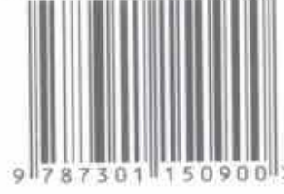

9787301150900>

定价：42.00元

www.cengageasia.com

网络加速器

t.tizi8.com

t.it520.cc

t.hi6.uk
<!-- page: 4 -->

的百分比。如果用 GDP 平减指数，两个相连年份的通货膨胀率用如下方法计算：

$$  第二年的 GDP\_{ 第一年的 GDP} $$

$$  第二年的通货膨胀率 =\frac{ 平减指数 }{ 第一年的 GDP 平减指数 }\times100\% $$

由于2009年的GDP平减指数从100上升到171，所以，通货膨胀率就是 $100\%\times(171-100)/100$，即71%。在2010年，GDP平减指数从前一年的171上升到240，因此，通货膨胀率是 $100\%\times(240-171)/171$，即40%。

GDP 平减指数是经济学家用来监测经济中平均物价水平，从而监测通货膨胀率的一个衡量指标。GDP 平减指数的得名是因为它可以用来从名义 GDP 中剔除通货膨胀——也就是说，“平减”名义 GDP 中由于物价上升而引起的上升。在下一章中，我们将考察经济中物价水平的另一个衡量指标，称为消费物价指数，届时我们还要说明这两个衡量指标之间的差别。

## 案例研究

## 近年来的真实 GDP

既然我们知道了如何定义和衡量真实GDP，那么我们就来考虑这个宏观经济变量说明了近年来美国经济的什么情况。图23-2显示了1965年以来美国经济真实GDP的季度数据。

图 23-2 美国的真实 GDP

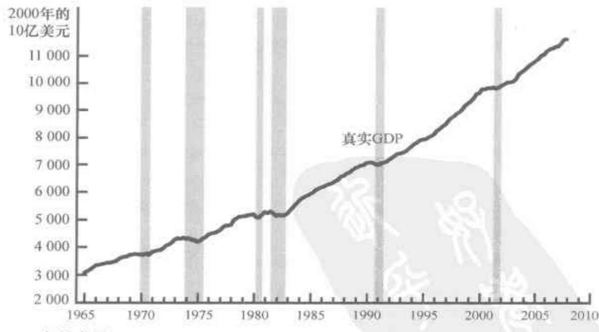

资料来源：U.S. Department of Commerce.

这些数据最明显的特点是真实GDP一直在增长。美国经济2007年的真实GDP几乎是1965年水平的4倍。换言之，美国生产的物品与劳务的产量平均每年增长3.2%左右。这种真实GDP的持续增长使普通美国

该图显示了1965年以来美国经济真实GDP的季度数据。衰退——真实GDP下降的时期——用垂直的阴影条表示。

第 23 章 一国收入的衡量

15

网络加速器
t.tizi8.com
t.it520.cc
t.hi6.uk
<!-- page: 5 -->
 1. 2. 3. 4. 5. 6. 7. 8. 9. 10. 11. 12. 13. 14. 15. 16. 17. 18. 19. 20. 21. 22. 23. 24. 25. 26. 27. 28. 29. 30. 31. 32. 33. 34. 35. 36. 37. 38. 39. 40. 41. 42. 43. 44. 45. 46. 47. 48. 49. 50. 51. 52. 53. 54. 55. 56. 57. 58. 59. 60. 61. 62. 63. 64. 65. 66. 67. 68. 69. 70. 71. 72. 73. 74. 75. 76. 77. 78. 79. 80. 81. 82. 83. 84. 85. 86. 87. 88. 89. 90. 91. 92. 93. 94. 95. 96. 97. 98. 99.

素。在本书的后面，我们将研究围绕真实GDP长期趋势的短期波动。

在本章我们分三步进行研究：第一，考察人均真实GDP的国际数据，这些数据使我们对世界各国生活水平与增长的差别大小有一个大体了解；第二，考察生产率——一个工人每小时生产的物品与劳务量——的作用，特别是说明一国的生活水平是由其工人的生产率决定的，并且考虑决定一国生产率的因素；第三，考虑生产率和一国采取的经济政策之间的联系。

#### 25.1 世界各国的经济增长

作为研究长期增长的出发点，我们先考察世界上一些国家的经济发展历程。表25-1说明了13个国家人均真实GDP的数据。对于每一个国家，数据都涵盖一个世纪的历史。该表的第一栏和第二栏列出了国家与时期（各国的时期略有不同，这是因为数据的可获得性不同），第三栏和第四栏列出了一个世纪前和最近一年的人均真实GDP的估计值。

表 25-1 不同的增长经历

<table border=1><tr><td>国家</td><td>时期</td><td>期初人均真实GDP*(美元)</td><td>期末人均真实GDP*(美元)</td><td>年增长率(%)</td></tr><tr><td>日本</td><td>1890—2006</td><td>1408</td><td>33150</td><td>2.76</td></tr><tr><td>巴西</td><td>1900—2006</td><td>729</td><td>8880</td><td>2.39</td></tr><tr><td>中国</td><td>1900—2006</td><td>670</td><td>7740</td><td>2.34</td></tr><tr><td>墨西哥</td><td>1900—2006</td><td>1085</td><td>11410</td><td>2.24</td></tr><tr><td>德国</td><td>1870—2006</td><td>2045</td><td>31830</td><td>2.04</td></tr><tr><td>加拿大</td><td>1870—2006</td><td>2224</td><td>34610</td><td>2.04</td></tr><tr><td>阿根廷</td><td>1900—2006</td><td>2147</td><td>15390</td><td>1.88</td></tr><tr><td>美国</td><td>1870—2006</td><td>3752</td><td>44260</td><td>1.83</td></tr><tr><td>印度</td><td>1900—2006</td><td>632</td><td>3800</td><td>1.71</td></tr><tr><td>英国</td><td>1870—2006</td><td>4502</td><td>35580</td><td>1.53</td></tr><tr><td>印度尼西亚</td><td>1900—2006</td><td>834</td><td>3950</td><td>1.48</td></tr><tr><td>孟加拉国</td><td>1900—2006</td><td>583</td><td>2340</td><td>1.32</td></tr><tr><td>巴基斯坦</td><td>1900—2006</td><td>690</td><td>2500</td><td>1.22</td></tr></table>

*真实GDP以2006年美元衡量。

资料来源：Robert J. Barro and Xavier Sala-i-Martin, Economic Growth (New York: McGraw-Hill, 1995), tables 10.2 and 10.3; World Development Report 2008, Table 1; and author's calculations.

人均真实GDP数据表明各国生活水平差别很大。例如，美国的人均收入约为中国的6倍，印度的12倍。最穷国家的人均收入水平是发达国家几十年来所未见的。2006年普通印度人的真实收入比1870年普通英

46

经济学原理

网络加速器

t.tizi8.com

t.it520.cc

t.hi6.uk
<!-- page: 6 -->

说明的，组成这个体系的机构——债券市场、股票市场、银行和共同基金——有协调经济中储蓄与投资的作用。而且，正如我们在前一章中说明的，储蓄与投资是长期GDP增长和生活水平提高的重要决定因素。因此，宏观经济学家需要知道金融市场如何运行以及各种事件和政策如何影响金融市场。

作为分析金融市场的出发点，这一节我们将讨论在这些市场中衡量经济活动的关键宏观经济变量。在这里，我们的重点不是行为而是核算。核算是指如何确定并加总各种数字。独立会计师会帮助个人加总收入与支出；国民收入会计师对整个经济做同样的事。国民收入账户特别包括了GDP以及许多相关的统计数字。

国民收入账户的规则包括几个重要的恒等式。我们还记得，恒等式是由于公式中定义变量的方式而必然正确的公式。记住这些恒等式是有用的，因为它们能清楚地说明不同变量相互之间的关系。我们先考虑一些说明金融市场宏观经济作用的会计恒等式。

#### 26.2.1 一些重要的恒等式

我们还记得，国内生产总值(GDP)既是一个经济的总收入，又是用于经济中物品与劳务产出的总支出。GDP(用Y表示)分为四部分支出：消费(C)、投资(I)、政府购买(G)和净出口(NX)。我们将其写为：

$$ Y=C+I+G+NX $$

这个等式之所以是恒等式，是因为左边列示的每一美元支出也列示在右边四个组成部分中的一个部分里。由于每一个变量定义与衡量的方式，这个等式必定总能成立。

在本章中，我们通过假设所考察的经济是封闭的而把分析简化。封闭经济是不与其他经济相互交易的经济。特别是，一个封闭经济既不进行物品与劳务的国际贸易，也不进行国际借贷。现实经济是开放经济——这就是说，它们与世界上其他经济相互交易。但是，假设一个封闭经济是一个有用的简化，利用这种简化我们可以了解一些适用于所有经济的结论，而且这个假设完全适用于世界经济（因为星际贸易尚未普及）。

由于一个封闭经济不进行国际贸易，进口与出口正好是零。因此，净出口(NX)也为零。在这种情况下，我们可以写出：

$$ Y=C+I+G $$

这个等式表明，GDP 是消费、投资和政府购买的总和。一个封闭经济中出售的每一单位产出都被消费、投资，或由政府购买。

为了说明这个恒等式对于金融市场的意义，从这个等式两边减去 C 和 G。我们得出：

$$ Y-C-G=I $$

等式的左边 $(Y-C-G)$是在用于消费和政府购买后剩下的一个经济

582

第 26 章 储蓄、投资和金融体系

77

网络加速器
t.tizi8.com
t.it520.cc
t.hi6.uk
<!-- page: 7 -->

8. 一个公司面临两种风险：企业特有风险是竞争者可能会进入其市场并夺走它的一些客户；市场风险是经济可能会进入衰退期，销售量减少。这两种风险中哪一种更可能使公司股东需要高收益？为什么？

9. 你有两个投资于股票市场的室友。

a. 一个室友说，她只买每个人都相信其未来利润会大大增加的公司的股票。你认为如何比较这些公司的价格—收益比率和其他公司的价格—收益比率？购买这些公司的股票会有什么不利之处？

b. 另一个室友说，他只买便宜公司的股票，他用低价格—收益比率来衡量。你认为如何比较这些公司的收益前景与其他公司的收益前景？购买这些公司的股票会有什么不利之处？

10. 当公司高层管理人员根据凭借其地位得到的私人信息买卖股票时，他们就是在进行内部人交易。

a. 举出一个对买卖股票有用的内部信息的例子。

b. 那些根据内部信息交易股票的人通常赚到极高收益率。这个事实违背了有效市场假说吗？

c. 内部人交易是非法的。为什么你认为它非法？

11. 找出指数基金的一些信息（例如先锋整体股票市场指数基金，交易代码为VTSMX）。过去5年或10年内，与其他股票共同基金相比，这种基金的业绩如何？（提示：可以在如下网站寻找共同基金数据：http://www.morningstar.com。）从这种比较中，你知道了什么？

108

经济学原理

网络加速器
t.tizi8.com
t.it520.cc
t.hi6.uk
<!-- page: 8 -->

## 第 29 章 货币制度

当你走进一家餐馆点了一份饭时，你得到了某种有价值的东西——饱餐一顿。为了对这种服务付费，你会递给餐馆老板几张破旧的，上面印有奇特的符号、政府大楼和已故美国名人肖像的淡绿色纸片。或者，你也可以拿出一张载有银行名称和你的签名的纸片。无论你是支付现金还是支票，餐馆老板都乐于为满足你的食欲而辛勤工作，以换取这些本身没有什么价值的纸片。

对于任何一个生活在现代经济中的人来说，这种社会习惯一点也不奇怪。尽管纸币没有内在价值，但餐馆老板相信未来会有第三个人接受它，由此餐馆老板可以换取他认为有价值的东西。而且，这第三个人也相信会有第四个人接受这些纸币，并知道还有第五个人也将接受它，如此等等。对餐馆老板和我们社会中的其他人来说，你的现金或支票代表了对未来物品与劳务的索取权。

使用货币进行交易的社会习惯在一个大而复杂的社会中是极其有用的。假设经济中没有这种在交换物品与劳务时被广泛接受的媒介，人们就不得不依靠物物交换——用一种物品或劳务交换另一种物品或劳务——来得到他们需要的东西。例如，你为了得到餐馆的一顿饭，你就必须提供对餐馆老板有直接价值的东西。你可以帮他洗一些盘子、给他擦汽车，或者把你家的肉糜糕秘方给他。一个依靠物物交换的经济，难以有效地配置其稀缺资源。在这种经济中，交易要求欲望的双向一致性——一种不大可能的偶然巧合，即两个人中每个人都有对方想要的物品或劳务。

货币的存在使贸易变得容易了。餐馆老板并不关心你是否能生产对他有价值的物品或劳务，他乐于接受你的货币，因为他知道其他人也会接受他的货币。这种惯例使交易循环往复地进行。餐馆老板接受你的货币，并把它支付给他的厨师；厨师又用她的工资支票送孩子上托儿所；托儿所用这些学费支付教师的工资；教师又雇你给她修剪草坪。随着货币在经济中从一个人手中流到另一个人手中，它便利了生产和贸易，从而使

641

642

第 29 章 货币制度

139

网络加速器
t.tizi8.com
t.it520.cc
t.hi6.uk
<!-- page: 9 -->

674 通货膨胀税：

政府通过创造货币而筹集的收入。

675

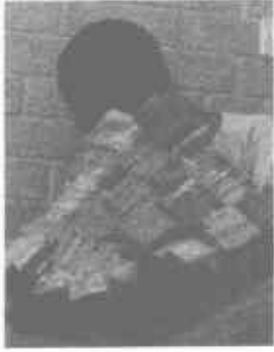

图片来源：�� AP IM-AGES.

答案是，这些国家的政府把货币创造作为支付其支出的一种方法。当政府想要修公路、支付军人薪水，或者对穷人或老年人进行转移支付时，它首先必须筹集必要的资金。在正常的情况下，政府可以通过征收所得税和销售税来筹资，也可以通过出售政府债券向公众借债来筹资。然而政府也可以简单地通过印发它需要的货币来为其支出进行支付。

当政府通过印发货币筹集收入时，可以说是在征收一种通货膨胀税（inflation tax）。但是，通货膨胀税和其他税并不完全一样，因为没有一个人从政府那里收到这种税的税单。相反，通货膨胀税是较为隐蔽的。当政府印发货币时，物价水平就会上升，你钱包里的美元就不值钱了。因此，通货膨胀税就像是一种向每个持有货币的人征收的税。

通货膨胀税的重要性在不同国家和不同时期并不相同。近年来，通货膨胀税一直不是美国主要的收入来源，由此取得的收入估计不到政府收入的3%。但在18世纪70年代期间，对刚成立不久的美国来说，美国国会主要依靠通货膨胀税来支付其军事支出。因为新政府通过正常税收或借款筹资的能力有限，所以印发美元就成为向美国军人支付工资的一种简单易行的方法。正如货币数量论所预言的，结果导致了高通货膨胀率：在短短几年间按大陆美元衡量的物价上涨了100多倍。

几乎所有超速通货膨胀都遵循了与美国独立战争时期超速通货膨胀相同的模式。政府面临高额支出，税收不足，而且借款能力有限，结果就只能通过印发钞票来为其支出进行支付。最终，货币量的大量增加引起了高通货膨胀。当政府实行消除通货膨胀税所需的财政改革措施时——例如，削减政府支出——通货膨胀就结束了。

## 新闻摘录

## 一 份面对经济灾难的处方

第一步，印大量的钱；第二步，试图通过控制物价来阻止通货膨胀；第三步，等着看经济规律奏效。

## 冻结工资是津巴布韦减轻通货膨胀的最后一招

Michael Wines

周五津巴布韦政府尝试了冻结工资、租金以及服务费6个月，这被一些分析家称作一场为维护高通货膨胀经济的、愈发疯狂的战役的最后一招。

在穆加贝总统(Robert G. Mugabe)宣布冻结之后，津巴布韦报纸评论说，这样缩小政府运转所需要的税收与2个月以来政府反通货膨胀的努力事与愿违。

新的冻结命令是由政府控制的报纸周五发布的，本意是要对付政府所说的超过7600%的年通货膨胀率，不过非官方的经济学家认为实际的年通货膨胀率是这个数字的两倍。这项冻结政策禁止企业通过按通货膨胀调整的指数工资或者费用，这是很多工资合同通常采用的方法。

170

经济学原理

网络加速器

t.tizi8.com

t.it520.cc

t.hi6.uk
<!-- page: 10 -->

美国物品，而更少地购买外国物品。结果美国出口增加而进口减少，这两种变化都增加了美国的净出口。相反，美国真实汇率的上升意味着与外国物品相比，美国物品变得昂贵了。因此，美国的净出口减少了。

即问即答 • 给出名义汇率与真实汇率的定义，并解释它们如何相关。• 如果名义汇率从1美元兑100日元上升到120日元，美元升值了还是贬值了？

## 新闻摘录

## 疲软的美元如何刺激出口

2007年，美元在外汇市场走弱，这使来自国外的买家受益。

随着美元走低，美国成了一间大卖场；

欧洲人成群结队来买便宜货

Jenn Ahelson

感恩节从都柏林飞抵波士顿几小时之后，Alice Kinsella 就和 12 个亲友乘坐一辆白色面包车径直前往 Wrentham Village Premium Outlets（大型季后折扣店）。36 岁的 Kinsella 第一次来波士顿，但是她略过景点，只想有个疯狂购物的长周末。

对于 Kinsella 和其他欧洲人来说，要感谢这一周又创下兑欧元新低的疲软美元，这使美国成为一个巨大的折扣店。结果旅游者花上千美元来到美国，大揽包括从 iPod 到设计师时装和手袋的便宜货。

截至昨天凌晨4点，Kinsella已经买了将近2000美元的圣诞礼物和冬装，包括一件Guess品牌的79美元的黑色皮夹克，她估计它在爱尔兰要卖到250美元以上。

“这些东西真是太便宜了，”Kinsella说，她花了1000美元在机票和酒店上，但是期望能从购物中节省更多。

Kinsella 是昨天组织结队而来 Wrentham Village Premium Outlets 进行购物之旅的 1000 名国际旅客之一，这个数字比去年翻了一番。据商店的总经理 Beth Winbourne 说，预计还有数百人会自行前来。

外国游客很久以来都在美国进行节日购物。毕竟，像 Tommy Hilfiger、Ralph Lauren 和 Guess 这些设计师品牌在美国要便宜些，因为在这里销售税较低，而且美国大市场使物品更具有竞争性价格。

现在，由于美国经济减缓削弱了美元，美国货就更便宜了。同时，由于美联储降低利率来刺激经济，美元贬值更多，全世界的投资者都认识到靠美元不再那么赚钱了。结果是自从2002年以来，欧元对美元升了33%，也就是欧洲人现在1000欧元可以换到将近1500美元；并且加拿大元也是30年中第一次和美元一样值钱了。

706

第 31 章 开放经济的宏观经济学：基本概念

201

网络加速器

t.tizi8.com

t.it520.cc

t.hi6.uk
<!-- page: 11 -->

网络加速器

t.tizi8.com

t.it520.cc

t.hi6.uk
<!-- page: 12 -->

## 案例研究 石油与经济

1970 年以来，美国经济中一些最大的经济波动起源于中东的产油地区。原油是生产许多物品与劳务的关键要素，而且世界大部分石油来自沙特阿拉伯、科威特和其他中东国家。当某个事件（通常起源于政治）减少了来自这个地区的原油供给时，世界石油价格就会上升。美国生产汽油、轮胎和许多其他产品的企业的成本就会增加，而且这些企业发现在任何一种既定的价格水平时供给它们的物品与劳务是无利可图的。结果总供给曲线向左移动，这又会引起滞胀。

第一起这种事件发生在20世纪70年代中期。石油储藏丰富的国家作为石油输出国组织成员（the Organization of Petroleum Exporting Countries，OPEC）走到了一起，OPEC是一个卡特尔——一个企图阻止竞争并减少生产以提高价格的卖者集团。而且，石油价格的确大幅度上升了。从1973年到1975年，石油价格几乎翻了一番。世界石油进口国都同时经历了通货膨胀和衰退。在美国，按CPI衡量的通货膨胀率几十年来第一次超过了10%，失业率也从1973年的4.9%上升到1975年的8.5%。

几乎完全相同的事件在几年后又发生了。在20世纪70年代末期，OPEC国家再一次限制石油的供给以提高价格。从1978年到1981年，石油价格翻了一番还多，结果又是滞胀。第一次OPEC事件引起的通货膨胀本已渐渐平息，但现在每年的通货膨胀率又上升到10%以上。由于美联储不愿意抵消这种通货膨胀的大幅度上升，所以经济很快又进入了衰退。失业从1978年和1979年的6%左右上升到几年后的10%左右。

世界石油市场也是总供给有利移动的来源。1986年OPEC成员之间爆发了争执，成员国违背了限制石油生产的协议。在世界原油市场上，价格几乎下降了一半。石油价格的下降减少了美国企业的成本，企业现在发现在任何一种既定的物价水平时供给物品和劳务都是更加有利可图的。结果，总供给曲线向右移动。美国经济经历了滞胀的反面：产量迅速增长，失业减少，而且通货膨胀率达到了多年来的最低水平。

近年来，世界石油市场并没有成为经济波动的重要来源。部分原因是，节油的努力和技术变革降低了经济对石油的依赖程度。生产一单位真实GDP所需的石油量自从20世纪70年代的OPEC冲击以来已下降了40%左右。结果，今天石油价格的任何变动对经济的影响都比过去小。

但是，不能过早地得出美国不再需要担心石油价格的结论。如果石油价格上升得足够高，宏观经济的结果就很可能类似于20世纪70年代的情形。在2008年，当本书即将付印时，世界石油价格的确正在大幅度上升，部分是由于迅速增长的中国的需求增加。这种石油价格上升使一些观察家担心，美国经济很可能又一次遭遇滞胀。

771

中东石油生产的变化是美国经济波动的一个原因。

图片来源：© KARIM SAHBE/AFP/GETTY IMAGES.

第 33 章 总需求与总供给

263

网络加速器
t.tizi8.com
t.it520.cc
t.hi6.uk
<!-- page: 13 -->

804

该图假设2020年物价水平为100，并画出了2021年的可能结果。（a）幅表示总需求与总供给模型。如果总需求低，经济在A点，产量低（15000）且物价水平也低（102）。如果总需求高，经济在B点，产量高（16000）且物价水平也高（106）。（b）幅显示了菲利普斯曲线的含义。当总需求低时得出了A点，失业率高（7%），而通货膨胀率低（2%）。当总需求高时得出了B点，失业率低（4%），而通货膨胀率高（6%）。

正如萨缪尔森和索洛的文章题目所表明的，他们关心菲利普斯曲线是因为他们相信这对决策者来说是一个重要的结论。特别是，他们说明了菲利普斯曲线给决策者提供了一个有各种可能的经济结果的菜单。通过改变货币政策与财政政策来影响总需求，决策者可以选择这条曲线上的任意一点。A点提供了高失业和低通货膨胀。B点提供了低失业和高通货膨胀。决策者可能会偏好低通货膨胀和低失业，但正如菲利普斯曲线概括的历史数据所表明的，这种组合是不可能的。根据萨缪尔森和索洛的看法，决策者面临着通货膨胀和失业之间的权衡取舍，并且菲利普斯曲线说明了这种权衡取舍。

#### 35.1.2 总需求、总供给和菲利普斯曲线

总需求与总供给模型为菲利普斯曲线所描述的有各种可能结果的菜单提供了一个简单的解释。菲利普斯曲线说明了，短期中出现的通货膨胀与失业的组合是由于总需求曲线的移动使经济沿着短期总供给曲线变动。正如我们在前两章中所看到的，在短期中物品与劳务总需求的增加引起产量增加、物价总水平上升。产量越多，意味着就业越多，从而失业率越低。此外，高物价水平转变为高通货膨胀率。因此，总需求变动在短期中使通货膨胀和失业反方向变动，这正是菲利普斯曲线所说明的一种关系。

为了更充分地说明这是如何发生作用的，我们来看一个例子。为了使数字简化，设想物价水平（例如，用消费物价指数衡量）在2020年等于100。图35-2表示由于总需求的力量在2021年可能出现的两种结果，一种结果是在总需求高时出现的，另一种结果是在总需求低时出现的。其中，(a) 幅用总需求与总供给模型表示这两种结果；(b) 幅用菲利普斯曲线表示同样的两种结果。

图 35-2 菲利普斯曲线如何和总需求与总供给模型相关

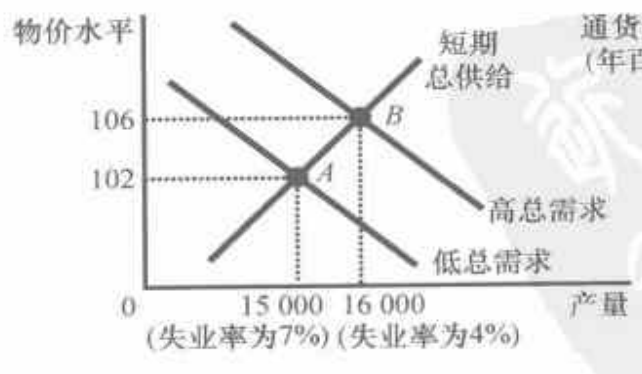

(a) 总需求与总供给模型

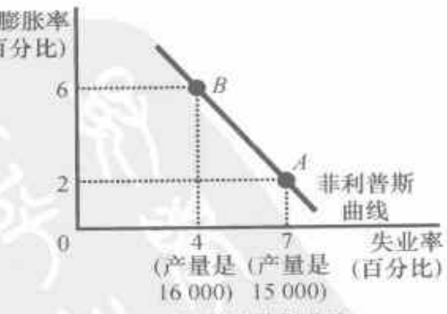

(b) 菲利普斯曲线

图 35-2(a) 幅显示了 2021 年产量和物价水平发生的变动。如果物

294

经济学原理

网络加速器
t.tizi8.com
t.it520.cc
t.hi6.uk
<!-- page: 14 -->

的做法是任命优秀人才实施货币政策，并给他们自由以使其尽可能做得最好。

此外，所谓的相机抉择问题很大程度上是假想的。例如，政治性经济周期的重要性在实践中并不明显。在某些情况下，情况看来正好相反。例如，1979年吉米·卡特总统任命保罗·沃尔克为联邦储备的领导人。然而，在那一年10月，沃尔克转向紧缩性货币政策，以便应对他从前任那里接手的高通货膨胀率。沃尔克决策的可预期结果是衰退，而且这种预期的衰退结果使卡特的支持率下降。沃尔克并没有用货币政策去帮助任命他的美国总统，而是出于国家利益采取了一些行动，即使这些行动使卡特在1980年11月的大选中被罗纳德·里根击败。

前后不一致性的重要性在实践中也很不明显。虽然大多数人怀疑中央银行的声明，但中央银行领导人可以通过实现自己的诺言而在长期中赢得信任。在20世纪90年代，尽管有利用通货膨胀与失业之间短期权衡取舍的诱惑，但美联储实现并维持了低通货膨胀率。这个经验表明，低通货膨胀率并不要求美联储服从于一个政策规则。

任何一种以规则替代相机抉择的努力都必然面临详细说明准确规则的艰难任务。尽管有许多研究考察了可供选择的不同规则的成本与收益，但经济学家们对于什么是好规则并没有达成共识。在没有达成这种共识之前，社会除了让中央银行领导人相机抉择地实施他们认为合适的货币政策之外别无选择。

即问即答 举出一个货币政策规则的例子。为什么你的规则可能会比相机抉择的政策更好？为什么可能更糟？

### 36.3 中央银行应该把零通货膨胀作为目标吗

在第1章中讨论过并在货币增长与通货膨胀这一章中更充分地揭示的经济学十大原理之一是，当政府发行了过多货币时，物价上升。在第1章中讨论过并在上一章更充分地揭示的经济学十大原理中的另一个是，社会面临通货膨胀与失业之间的短期权衡取舍。把这两个原理放在一起就向决策者提出了一个问题：中央银行愿意忍受的通货膨胀应该是多少？我们的第三个争论问题就是，通货膨胀率的适当目标是否为零。

#### 36.3.1 赞成: 中央银行应该把零通货膨胀作为目标

通货膨胀并没有给社会带来什么好处，却引起了一些实际成本。正

835

836

第 36 章 宏观经济政策的五个争论问题

325

网络加速器

t.tizi8.com

t.it520.cc

t.hi6.uk
<!-- page: 15 -->

减少自然失业率的政策（policies to reduce），807—808

自然资源（Natural resources），556

与总供给曲线移动（aggregate-supply curve shifts and），754

作为对增长的限制（as limit to growth），558—560

人均自然资源，与生产率（per worker，and productivity），556

人口增长与紧张（population growth and stretching），568—569

资本净流出（Net capital outflow），696，696—702

与净出口相等（equality with net exports），697—698

两个市场之间的联系（link between two markets），721—722

美国的资本净流出（in United States），700—702

净出口（Net exports），514，692

引起总需求曲线移动（aggregate-demand curve shifts from），747—748，751

与资本净流出的相等（equality with net capital outflows），697—698

汇率效应（exchange-rate effect），747—748

GDP中的净出口（in GDP），514—515

贸易政策（trade policies），728—730

国外净投资（Net foreign investment），696

荷兰，失业补助（Netherlands，unemployment benefits），627

国民生产净值（Net national product（NNP）），513

神经经济学（Neuroeconomics），608—609

纽约证券交易所（New York Stock Exchange），578

尼日利亚（Nigeria）

无形资本（intangible capital），559

生活水平（living standard in），523，549，550

法制指数（rule-of-law index），559

名义汇率（Nominal exchange rate），703，703

在超速通货膨胀期间（during hyperinflation），709

名义GDP（Nominal GDP），516

货币流通速度与货币数量（velocity and quantity of money），670—671

名义利息，税收待遇（Nominal interest，tax treatment of），680—681

名义利率（Nominal interest rate），539—540，540

费雪效应（Fisher effect），674，676

美国的名义利率（in United States），541

名义变量（Nominal variables），669

北美自由贸易协定（North American Free Trade Agreement（NAFTA）），696

营养，与经济增长（Nutrition，economic growth and），565—566

## 0

石油行业（Oil industry）

与总供给曲线移动（shifts in aggregate-supply curve and），770—771

与供给冲击（supply shocks and），812—815，820

奥林匹克比赛胜者与GDP（Olympic Games，winners at and GDP），524

OPEC。参看“石油输出国组织”（See Organization of Petroleum Exporting Countries（OPEC））

开放经济（Open economies），581，691—712，692，715—733。参看“汇率”、“国际流动”、“购买力平价”（See also Exchange rate；International flows；Purchasing-power parity）

开放经济中的均衡（equilibrium in），721—723

开放经济中的政府预算赤字（government budget deficit），724—728

外汇市场（market for foreign-currency exchange），718—721

可贷资金市场（market for loanable funds），716—718

政治不稳定和资本外逃（political instability and capital flight），730—733

贸易政策（trade policy），728—730

美国的开放经济（of United States），693—696

公开市场操作（Open-market operation），649，653

经济合作与发展组织（Organization for Economic Cooperation and Development）

无形资本（intangible capital），559

法制指数（rule-of-law index），559

石油输出国组织（Organization of Petroleum Exporting Countries（OPEC））

与石油价格上升（increase in oil prices and），770—771

356

经济学原理

网络加速器
t.tizi8.com
t.it520.cc
t.hi6.uk
<!-- page: 16 -->

## 义务教育教科书

数学 九年级上册

<table border=1><tr><td>主 编</td><td>杨裕前</td><td>董林伟</td></tr><tr><td>责任编辑</td><td>许礼光</td><td>闵正年 沈 琼</td></tr><tr><td>责任校对</td><td>仲 敏</td><td></td></tr><tr><td>出 版</td><td colspan="2">江苏凤凰科学技术出版社</td></tr><tr><td>出版社地址</td><td colspan="2">南京市湖南路1号A楼,邮编:210009</td></tr><tr><td>重 印</td><td colspan="2">江苏凤凰出版传媒股份有限公司</td></tr><tr><td>发 行</td><td colspan="2">江苏凤凰出版传媒股份有限公司</td></tr><tr><td>照 排</td><td colspan="2">江苏凤凰制版有限公司</td></tr><tr><td>印 刷</td><td colspan="2">江苏凤凰新华印务集团有限公司</td></tr><tr><td>开 本</td><td colspan="2">787 mm×1 092 mm 1/16</td></tr><tr><td>印 张</td><td colspan="2">9.75</td></tr><tr><td>版 次</td><td colspan="2">2006年6月第1版 2014年6月第3版</td></tr><tr><td>印 次</td><td colspan="2">2021年5月第16次印刷</td></tr><tr><td>标准书号</td><td colspan="2">ISBN 978-7-5537-2974-9</td></tr><tr><td>定 价</td><td colspan="2">9.65元</td></tr></table>

如发现印、装质量问题，请与凤凰传媒联系，电话：400-828-1132
<!-- page: 17 -->

## 致同学

## 亲爱的伙伴：

祝贺你升入九年级！

两年来我们在数学王国里探索，翻过了一座座“山峰”，当你蓦然回首时，会发现自己“长高”了。这册课本将陪伴你继续攀登，进一步领略数学王国里的多姿多彩。

“一元二次方程”是又一个刻画现实世界数量关系的数学模型，你将在学习一元二次方程各种解法的过程中，进一步体会转化的思想，并尝试应用一元二次方程的知识解决一些实际问题。

红日、车轮、硬币……圆象征着完美、和谐，“对称图形——圆”将引导你运用圆的对称性探索圆的一些性质，运用图形运动和推理的方法证实圆的有关性质。

“数据的集中趋势和离散程度”将介绍平均数、中位数、众数和方差，并引导你根据具体问题，选用这些统计量来描述、分析数据。

袋子中装有红球、白球、黑球各1个，这些球除颜色外都相同。搅匀后从中摸出1个球，摸到红球、白球、黑球的可能性相同吗？学习了“等可能条件下的概率”以后，你将会计算这样的一类事件发生的概率。

“实践与探索”、“观察与思考”、“操作与思考”、“尝试与交流”、“思考与探索”、“拓展与延伸”等，本册课本设计的这些栏目，不仅有助于你学懂知识、学会技能，而且能引导你体会数学的本质，感悟基本数学思想。
<!-- page: 18 -->

<!-- page: 19 -->

一块石头从离海面 $45 \mathrm{~m}$ 高的绝壁上落下，试估计这块石头经过多少时间落到海面。

设石头在下落过程中离海面的高度 $h$ 与下落的时间 $t$ 有如下的关系：

$$ h = - 5 t ^ {2} + 4 5 . $$

1. 填表：

<table border=1><tr><td>t/s</td><td>0</td><td>0.5</td><td>1</td><td>1.5</td><td>2</td><td>2.5</td><td>...</td></tr><tr><td>h/m</td><td></td><td></td><td></td><td></td><td></td><td></td><td>...</td></tr></table>

2. 石头经过多少时间落到海面？

本章将学习一元二次方程的概念、解法和应用。
<!-- page: 20 -->

��.2 一元二次方程的解法

练习

1. 填空：

(1) $x^{2}-2x+\_\=(x-\_\)^{2}$;

(2) $x^{2}+8x+\_\=(x+\_\)^{2}$;

(3) $x^{2}-5x+\_\=(x-\_\)^{2}$;

(4) $x^{2}+\frac{3}{2}x+\_\=(x+\_\)^{2}.$

2. 解下列方程：

(1) $x^{2}+2x=3$;

(2) $x^{2}-6x=4$;

(3) $x^{2}+10x+20=0$;

(4) $x^{2}-x-1=0$.

当一元二次方程的二次项系数不是1时，怎样用配方法求解？

把二次项系数化为1.

例 4 解方程： $2x^{2}-5x+2=0$

解：两边都除以2，得

$$ x^{2}-\frac{5}{2}x+1=0. $$

移项，得

$$ x^{2}-\frac{5}{2}x=-1. $$

配方，得

$$ x^{2}-\frac{5}{2}x+\left(\frac{5}{4}\right)^{2}=-1+\left(\frac{5}{4}\right)^{2}, $$

$$ \left(x-\frac{5}{4}\right)^{2}=\frac{9}{16}. $$

解这个方程，得

$$ x-\frac{5}{4}=\pm\frac{3}{4}. $$

所以

$$ x_{1}=\frac{1}{2},x_{2}=2. $$

13
<!-- page: 21 -->

第1章 一元二次方程

### 1.4 用一元二次方程解决问题

我们已经知道，生产、生活中的一些实际问题，有时可以用一元二次方程来描述其中数量之间的相等关系，运用一元二次方程的有关知识，常常可以使这些实际问题得到解决。

问题 1 用一根长  $22 \, cm$ 的铁丝：

(1) 能否围成面积是  $30 \, cm^{2}$ 的矩形？

(2) 能否围成面积是  $32 \, cm^{2}$ 的矩形？

解：设这根铁丝围成的矩形的长是  $x \, cm$，则矩形的宽是  $(11 - x) \, cm$。

(1) 根据题意，得

$$ x(11-x)=30, $$

即

$$ x^{2}-11x+30=0. $$

解这个方程，得

$$ x_{1}=5,x_{2}=6. $$

当  $x_{1}=5$ 时， $11-x_{1}=6$；

当  $x_{2}=6$ 时， $11-x_{2}=5$。

答：用一根长  $22 \, cm$ 的铁丝能围成面积是  $30 \, cm^2$ 的矩形。

(2) 根据题意，得

$$ x(11-x)=32, $$

即

$$ x^{2}-11x+32=0. $$

因为  $b^{2}-4ac=(-11)^{2}-4\times1\times32=121-128=-7<0$

所以此方程没有实数根.

答：用一根长  $22 \, cm$ 的铁丝不能围成面积是  $32 \, cm^2$ 的矩形。

24
<!-- page: 22 -->

��.4 圆周角

于是，我们得到如下定理：

圆周角的度数等于它所对弧上的圆心角度数的一半，同弧或等弧所对的圆周角相等。

因为圆心角的度数与它所对的弧的度数相等，所以我们也可以说，圆周角的度数等于它所对弧的度数的一半。

例 1 如图 2-27，���O 的弦 AB、DC 的延长线相交于点 E， $\angle AOD = 150^{\circ}$， $\widehat{BC}$ 为  $70^{\circ}$。求  $\angle ABD$、 $\angle AED$ 的度数。

解：在���O中，

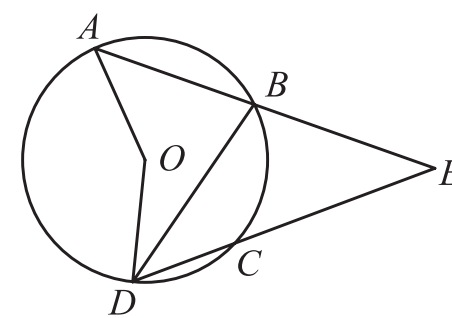

图 2−27

$\because \angle AOD = 150^{\circ},$

$\therefore \angle ABD = 75^{\circ}$ (圆周角的度数等于它所对弧上的圆心角度数的一半).

$\because \widehat{BC}$ 为  $70^{\circ}$,

$\therefore \angle BDC = 35^{\circ}$ (圆周角的度数等于它所对弧的度数的一半).

又��  $\angle ABD = \angle AED + \angle BDC$,

$\therefore \angle AED = \angle ABD - \angle BDC = 75^\circ - 35^\circ = 40^\circ.$

1. 下列各图中的角是否是圆周角？为什么？

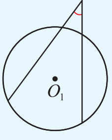

��

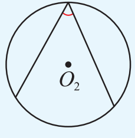

��

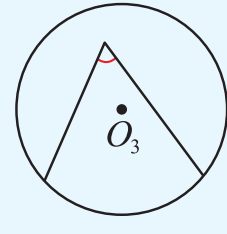

��

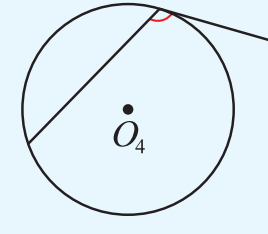

��

(第1题)

55
<!-- page: 23 -->

第2章 对称图形——圆

### 2.8 圆锥的侧面积

我们把连接圆锥的顶点和底面圆上一点的线段叫做圆锥的母线．如图 2−62，线段 SA 是圆锥的母线．

在图 2−62 中，设圆锥的母线长为 l，圆锥的底面圆半径为 r，你能计算圆锥的侧面积吗？

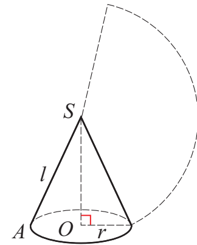

图 2−62

圆锥的侧面展开图是一个扇形.

这个扇形的那长是圆锥底面圆周长，半径是圆锥的母线长，圆锥的侧面积为 $\frac{1}{2}2\pi r l=\pi r l$.

例 用铁皮制作的圆锥形容器盖如图 2−63 所示，求这个容器盖铁皮的面积(精确到  $1 \, cm^{2}$).

解：圆锥形容器盖的底面圆周长为  $2\pi \times 40 = 80\pi$.

容器盖的面积

$$ \begin{aligned}S&=\frac{1}{2}\times80\pi\times50\\&\approx6\ 280.\end{aligned} $$

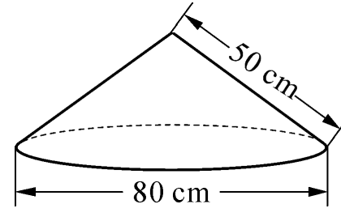

图 2−63

答：这个圆锥形容器盖铁皮的面积约为  $6280 \, cm^{2}$

在半径为 $\sqrt{2}$的圆形纸片中，剪一个圆心角为 $90^{\circ}$的扇形(图2-64中的阴影部分).

(1) 求这个扇形的面积(结果保留  $\pi$);

(2) 若用剪得的扇形纸片围成一个圆锥的侧面，能否从剪下的 3 块余料中选取一块，剪出一个圆作为这个圆锥的底面？

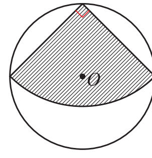

图 2−64

86
<!-- page: 24 -->

第 3 章 数据的集中趋势和离散程度

2. 某校九年级(1)班学生的身高如图所示(单位：cm);

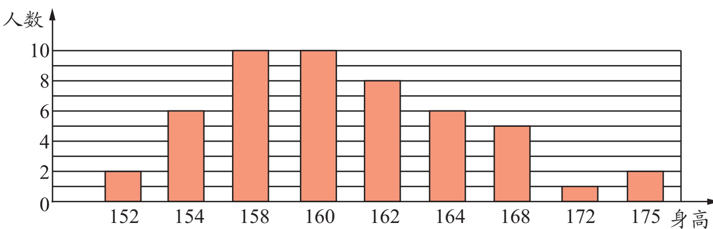

(第2题)

用计算器计算该班学生的平均身高.

112
<!-- page: 25 -->

第 3 章 数据的集中趋势和离散程度

### 3.5 用计算器求方差

我们也可以用计算器来计算一组数据的平均数、方差。

甲、乙两人在相同条件下 10

次射击的成绩如下(单位：环)：

甲：10，7，8，8，8，8，8，

8，9，6；

乙：8，8，8，8，5，8，8，

9，9，9.

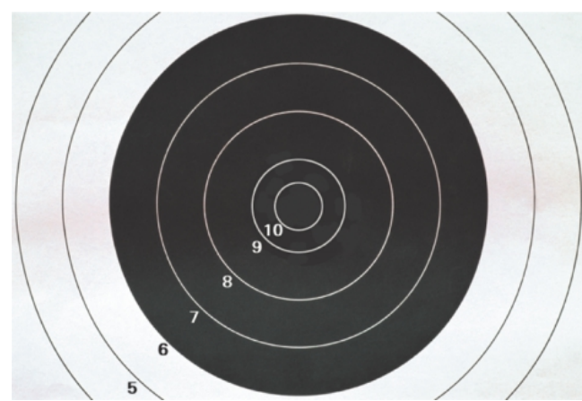

用计算器计算这两组数据的平均数、方差，比较甲、乙两人射击成绩的稳定性.

方法一：

按开机键 ON 后，首先将计算器功能模式设定为统计模式，

依次按键：

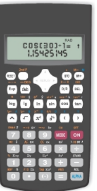

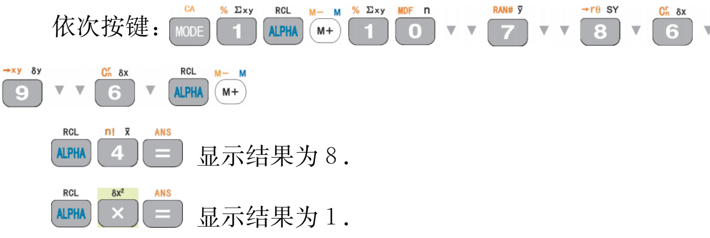

显示结果为 8.

显示结果为 1.

即甲射击成绩的平均数  $\bar{x}=8$，方差  $s^{2}=1$。

依次按键：

显示结果为 8.

显示结果为 1.2.

即乙射击成绩的平均数  $\bar{x}=8$，方差  $s^{2}=1.2$。

118
<!-- page: 26 -->

## 第4章 等可能条件下的概率

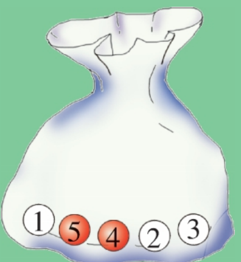

�� �� �� �� ��

摸球、抛硬币……试验的结果具有等可能性，列举法帮助我们计算这类简单事件的概率。

$P(\text{摸到白球}) = \frac{3}{5}$

第一次抛掷

第二次抛掷

所有可能出现的结果

开始

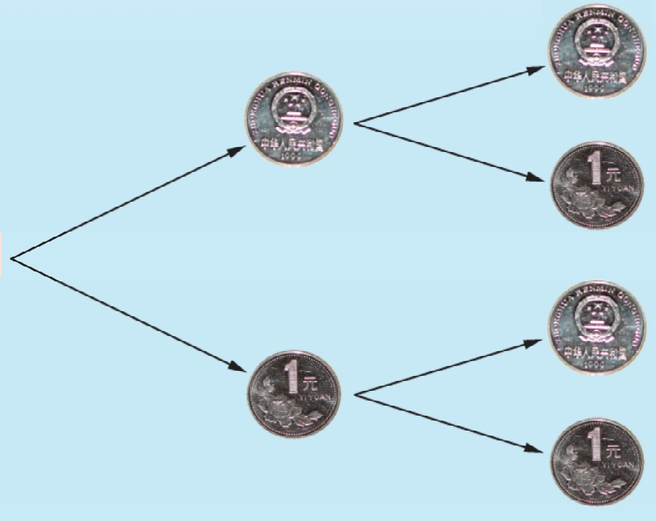

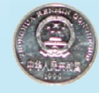

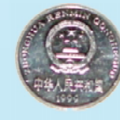

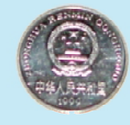

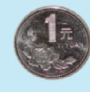

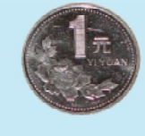

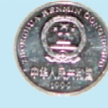

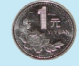

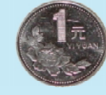
<!-- page: 27 -->

数学活动

在正方形 ABCD 内任取一点 O，连接 OA、OB（如图）。如果正方形 ABCD 内每一点被取到的可能性都相同，分别求  $\triangle OAB$ 是钝角三角形和直角三角形的概率。

“△OAB 是钝角三角形”这个事件发生相当于点 O 恰好落在以 AB 为直径的半圆内，所以

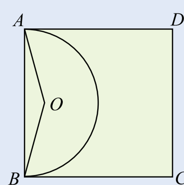

$P(\triangle OAB$ 是钝角三角形 $)=\frac{AB$ 为直径的半圆的面积}{正方形 ABCD 的面积} $=\frac{\frac{1}{2}\pi\cdot\left(\frac{AB}{2}\right)^{2}}{AB^{2}}=\frac{\pi}{8}$

同理，“△OAB 是直角三角形”这个事件发生相当于点 O 恰好落在以 AB 为直径的半圆上，所以

$P(\triangle OAB$ 是直角三角形 $)=\frac{\widehat{AB}$ 的面积}{正方形 ABCD 的面积}=0.

注意，这个例子中，“△OAB 是直角三角形”这个事件发生的概率是 0！但这并不意味着这个事件不会发生，我们只能说该事件发生的概率为 0。这就是说，概率为 0 的事件不一定是不可能事件。

## 数学活动

## 调查“小概率事件”

人们常说：“只要有百分之一的希望，就要做百分之百的努力”、“不怕一万，就怕万一”。

概率接近于 0 的事件叫做小概率事件．生活中，通常把概率不超过 0.05 的事件看成是小概率事件．

小概率事件不是不可能事件．对于一个事件，不论它发生的概率有多小，只要重复试验的次数足够多，这个事件总是可能发生的．例如，体育彩票中奖的概率远小于0.05，但由于买彩票的人足够多，最终总会有人中奖．

小概率事件与我们的生活息息相关。“只要有百分之一的希望，就要做百分之百的努力”，就是说，对于一些有益的小概率事件，如人体造血干细胞的配对等，我们总希望通过努力尽可能促使其发生。“不怕一万，就怕万一”，就是说，对于造成严重损失的一些小概率事件，如交通事故、矿难、地震、海啸等，我们要强化安全管理，严加防范，尽量避免这些事件的发生或尽量减少损失。

组织一次社会调查，收集、整理生活中的小概率事件，并发表你对这些小概率事件的看法。

143
<!-- page: 28 -->

## 后 记

本套教材是以《义务教育数学课程标准(2011年版)》为依据，在广泛听取专家、实验区师生的意见和建议的基础上，对《义务教育课程标准实验教科书数学(苏科版)》(以下简称“实验本”)进行修订而成的，供义务教育7～9年级使用。

本套教材每章的开头部分设置：章头图，章头语，章头问题，本章内容概述。

每章的内容部分设置：

“数学实验室”——通过“做”数学，感悟、理解数学知识；

“数学活动”——运用本章知识解决一些简单的问题；

“阅读”和“读一读”——介绍数学思想方法、拓展课本内容；

“练一练”——按课时编写，供当堂练习用；

“习题”——按节编写，供本节各个课时课后作业用。

每章的末尾部分设置：

“小结与思考”——梳理本章知识的结构、提炼基本思想；

“复习题”（分为复习巩固、灵活应用、探索研究三个层次）——供本章复习时用，其中“灵活应用”、“探索研究”部分的习题可根据实际情况选用。

本套教材的每册课本设置一个“课题学习”——综合运用有关知识解决实际问题。全书使用了卡通人“小明”、“小丽”，并根据课程内容展开的需要，编写了一些卡通语。

“实验本”教材由杨裕前、董林伟任主编，丁伟明、李善良曾任副主编。参与本册各章（“实验本”）编写的有朱建明、周凯、孔凡海。

修订后的本套教材由杨裕前、董林伟任主编，参与本册修订的编写人员有周凯、杨秋萍、徐延觉、朱建明、荆福仁；参与修订讨论的有王永建、周学祁、陈志廉。

史宁中教授、顾����教授、张英伯教授等专家、同行，对本套教材的修订给予了热情的帮助和指导，提出了许多宝贵的意见和建议，在此表示衷心感谢！
<!-- page: 29 -->

<!-- page: 30 -->
定价
：
9
.65
元
审批号
：苏费核
（2021
年
）0097
号 举报电话
：12315